<!--
**Riskypr/Riskypr** is a special repository because its README.md appears on your GitHub profile.
-->

<div align="center">



<a href="https://git.io/typing-svg">
  
</a>

<br/>


</div>

---

## `~/about` $ whoami

```bash
$ cat about.md
name      : Risky Prasetyo
major     : Informatics Engineering
focus     : Fullstack Development, Data Science
learning  : AI Engineering, Machine Learning
mode      : build useful things, ship them, repeat

$ git status
On branch main
Your branch is ahead of 'sleep' by 99 commits.
```

---

## `package.json`

```json
{
  "name": "risky-prasetyo",
  "version": "2026.11.0",
  "main": "fullstack-developer",
  "scripts": {
    "dev": "learn --ai --ml",
    "build": "ship useful-projects",
    "test": "break-it-then-fix-it",
    "coffee": "brew --refill"
  },
  "dependencies": {
    "languages": ["PHP", "JavaScript", "Python"],
    "frameworks": ["Laravel", "Next.js", "Node.js"],
    "styling": ["Tailwind CSS", "Bootstrap"],
    "tools": ["Git", "VS Code"]
  },
  "devDependencies": {
    "curiosity": "latest",
    "patience": "^0.5.0",
    "stackoverflow": "*"
  }
}
```

<div align="center">


</div>

---

## `git log` --oneline

```text
* e7a91c4 (HEAD -> main) feat: start learning AI & Machine Learning
* b42d0f8 feat: pick up Data Science
* 9c13a5e feat: build fullstack apps with Laravel & Next.js
* 1a2b3c4 init: hello world, Informatics Engineering
```

---

## `./stats.sh`

<div align="center">


<br/>


</div>

<details>
<summary><code>$ open contribution-graph</code></summary>
<br/>


</details>

---

## `./projects`

<div align="center">

<a href="https://github.com/Riskypr/NAMA-REPO-1">
  
</a>
<a href="https://github.com/Riskypr/NAMA-REPO-2">
  
</a>

<a href="https://github.com/Riskypr/NAMA-REPO-3">
  
</a>
<a href="https://github.com/Riskypr/NAMA-REPO-4">
  
</a>

</div>

---

## `TODO.md`

- [x] Build fullstack web apps (Laravel, Next.js)
- [ ] Understand how models actually learn, not just call the API
- [ ] Get comfortable with data pipelines and analysis
- [ ] Contribute to open source
- [ ] Fix that one bug that only happens in production

---

## `./random-dev-joke`

<div align="center">


</div>

---

## `./contact`

<div align="center">

<a href="https://www.linkedin.com/in/risky-prasetyo-905423256/">
  
</a>
<a href="https://www.instagram.com/riskyprasetyo20">
  
</a>
<a href="https://github.com/Riskypr">
  
</a>

<br/><br/>

```bash
$ echo "Coding is like solving puzzles: the harder it gets, the more exciting it becomes"
$ exit 0
[Process completed]
```

</div>
```
